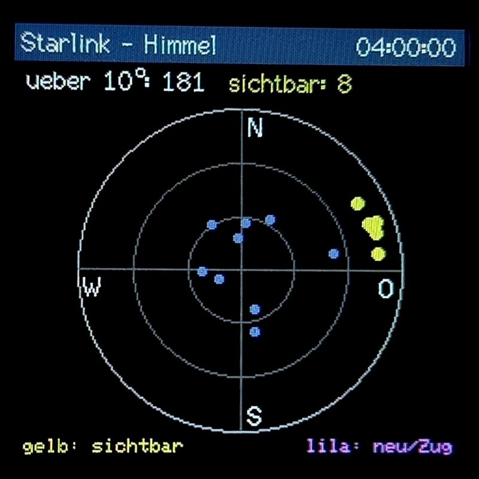
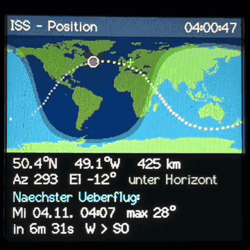
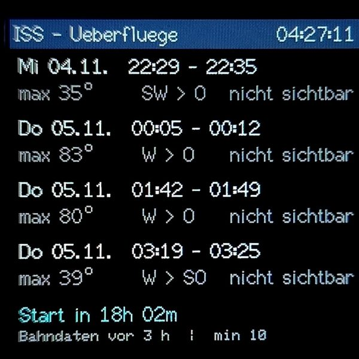
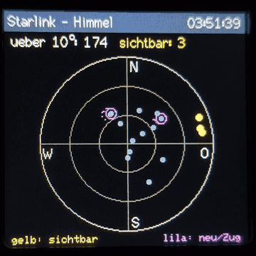
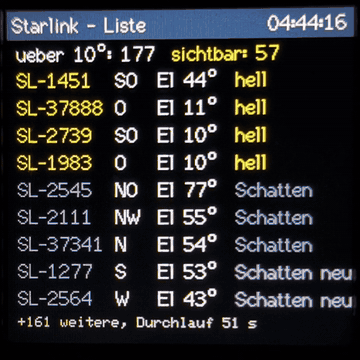

<p align="center"></p>

# SatTracker für GeekMagic SmallTV-Ultra

Eigene Firmware für das SmallTV-Ultra (ESP8266, 240×240-Display), die die **ISS** und
die **Starlink-Satelliten über deinem Standort** in Echtzeit anzeigt.

> Inoffizielles Hobbyprojekt, nicht von GeekMagic. Benutzung auf eigene Gefahr.
> Die Original-Firmware lässt sich jederzeit wieder einspielen (siehe unten).

<p align="center"></p>

## Ansichten (wechseln automatisch, oder fest einstellbar)

| ISS – Position | ISS – Überflüge |
|:---:|:---:|
|  |  |
| **Starlink – Himmel** | **Starlink – Liste** |
|  |  |

1. **ISS – Position:** Weltkarte mit Tag/Nacht-Grenze, ISS-Position, Bodenspur
   (−30 bis +60 min), Höhe, Azimut/Elevation und Countdown zum nächsten Überflug.
2. **ISS – Überflüge:** die nächsten 4 Überflüge mit Uhrzeit, max. Höhe, Richtung
   und ob die ISS dabei mit bloßem Auge **sichtbar** ist (angestrahlt bei dunklem Himmel).
3. **Starlink – Himmel:** Himmelskarte (N oben, O rechts, Mitte = Zenit) mit den
   Starlink-Satelliten über der Mindesthöhe.
   - Gelb: optisch sichtbar
   - Grau: es ist Tag
   - Blau: im Erdschatten
   - Lila Ring: frisch gestartet bzw. tief fliegend („Starlink-Zug“)
4. **Starlink – Liste:** die besten 9 Kandidaten mit Richtung, Höhe und Status.

## Technik in Kürze

- **Bahndaten:** Die TLEs kommen von celestrak.org, für die ISS alle 12 h und für
  Starlink alle 24 h.
- **Bahnberechnung:** SGP4 läuft direkt auf dem ESP8266.
- **Starlink-Datei:** Die ca. 10.600 Starlink-Bahnen liegen kompakt (48 Byte pro
  Satellit, ca. 500 KB) im Dateisystem der Original-Firmware.
- **Hintergrund-Durchlauf:** Er rechnet alle Satelliten reihum durch. Die 16 besten
  über dem Horizont werden jede Sekunde neu berechnet.
- **Dateisystem bleibt erhalten:** Das Dateisystem der Original-Firmware wird
  **nicht formatiert**. Fotos und Weboberfläche bleiben, damit ein Rückwechsel klappt.
- **Datenabruf:** Er läuft über HTTP, weil TLS weder ins OTA-Limit noch in den RAM
  passt. Jede TLE-Zeile wird per Prüfsumme kontrolliert.

## Hardware

Benötigt wird ein **GeekMagic SmallTV-Ultra** mit ESP8266 (ESP-12F), erhältlich z. B. im
[GeekMagic Outlet Store auf AliExpress](https://www.aliexpress.com/item/1005011742070248.html)
ab ca. 11 € (Stand: November 2026). Die Gehäusefarbe spielt keine Rolle.

> Beim Kauf auf die Variante achten: Die Firmware läuft **nur auf der ESP8266-Version**.
> Das SmallTV-Pro (ESP32) und neuere Modelle mit ESP32-C2 werden nicht unterstützt.
> Kein Affiliate-Link, der Verfasser verdient daran nichts.

## Flashen (per WLAN, ohne Aufschrauben)

1. `SatTracker-1.0.4.bin` unter **Releases** (rechts auf der GitHub-Seite) herunterladen.
2. Weboberfläche des Geräts öffnen: `http://<IP des Geräts>`. Die IP zeigt die
   Original-Firmware auf dem Display bzw. im Router.
3. Bereich **Update / Firmware Upgrade** öffnen (`/update`), die `.bin` auswählen und
   hochladen. Danach startet das Gerät neu.
4. Das Gerät verbindet sich mit dem WLAN, das die Original-Firmware gespeichert hat.
   Auf dem Display erscheint die IP-Adresse.
5. Beim ersten Start ermittelt es den Standort automatisch (siehe unten) und lädt die
   Bahndaten. Das dauert für Starlink ca. 1–2 Minuten.

MD5 von `SatTracker-1.0.4.bin`: `bea78261de85643f4fb3ba04b7ec45bc`

Ein Update auf eine neuere SatTracker-Version geht genauso, über `http://<IP>/update`.

**Falls das WLAN nicht klappt:** Das Gerät öffnet den Access Point
**SatTracker-Setup** (Passwort `sattracker`). Damit verbinden, http://192.168.4.1
öffnen und die WLAN-Daten eingeben.

## Weboberfläche

`http://<IP>` oder `http://sattracker.local` bietet:

- Status und alle sichtbaren Satelliten
- Einstellungen: Standort, Mindesthöhe, Helligkeit, Ansicht, Wechselintervall
- „Standort automatisch ermitteln“
- „Bahndaten neu laden“
- Firmware-Update

## Standort

Beim ersten Start mit WLAN fragt das Gerät einmalig [ip-api.com](https://ip-api.com)
nach dem ungefähren Standort des Internetanschlusses. Klappt das nicht, versucht es
das alle 30 Minuten erneut. Bis dahin gilt Frankfurt am Main (50,111° N / 8,682° O).

- **Genauigkeit:** meist Stadt oder Region, je nach Anbieter auch 20–50 km daneben.
  Für die Satelliten reicht das. Wer es genauer will, trägt die Koordinaten selbst ein.
- **Manuelle Eingabe hat Vorrang:** Geänderte Koordinaten in den Einstellungen werden
  nie automatisch überschrieben. Der Knopf „Standort automatisch ermitteln“ holt die
  automatische Bestimmung bei Bedarf zurück.
- **Höhe:** Der Dienst liefert keine Höhe. Sie bleibt bei 112 m, bis man sie selbst
  einträgt. Für die Berechnung macht das praktisch keinen Unterschied.
- **Datenschutz:** Bei der Abfrage geht die öffentliche IP-Adresse an ip-api.com.
  Wer das nicht möchte, trägt den Standort direkt nach dem Flashen manuell ein.
  Die Abfrage läuft über HTTP, weil TLS nicht in den Speicher passt.

JSON für eigene Auswertungen: `http://<IP>/api`

## Zurück zur Original-Firmware

Die Original-Firmware (getestet mit `FW-Smalltv-Ultra-V9.0.50.bin`) gibt es beim
Hersteller GeekMagic. Sie ist aus urheberrechtlichen Gründen nicht in diesem
Repository enthalten. Auf der SatTracker-Weboberfläche unter **Firmware hochladen**
einspielen.

MD5 von V9.0.50: `a5fe50093ada3c2637225bbf306a62c3`

## Sicherheitsnetz

- Die Weboberfläche mit `/update` startet vor allem anderen.
- Nach **3 Abstürzen in Folge** startet nur noch der **Sicherheitsmodus**: WLAN und
  Firmware-Update, sonst nichts.
- Ein Notfall-Zugang bleibt trotzdem: das Gerät aufschrauben und einen
  USB-Seriell-Adapter an TX/RX/GND anschließen. GPIO0 beim Einschalten auf GND legen.

## Hardware-Hinweise

- **Display-Pins:** SCLK 14, MOSI 13, CS fest auf GND, DC 0, RST 2, Backlight 5
  (LOW = an), ST7789 im SPI-Modus 3. Auf dem Gerät getestet.
- **Farben:** Sind Rot und Blau vertauscht, muss in `platformio.ini`
  `TFT_RGB_ORDER` auf `TFT_RGB` geändert werden.
- **Kein Taster:** Das SmallTV-Ultra hat keinen nutzbaren Touch-Taster, auch die
  Original-Firmware reagiert auf Berührung nicht. Die Ansicht wird daher über die
  Weboberfläche festgelegt.
- **Dauer eines Starlink-Durchlaufs:** Sie wird auf der Weboberfläche angezeigt und
  liegt bei ca. 50 s für ca. 10.600 Satelliten.

## Selbst bauen

```bash
pip install platformio
pio run
```

Die fertige Datei liegt danach unter `.pio/build/smalltv-ultra/firmware.bin`.
Scheitert der Build unter Windows an der Pfadlänge, in `platformio.ini` die Zeile
`workspace_dir` aktivieren. Die Datei liegt dann unter `<workspace_dir>/build/smalltv-ultra/`.

Hilfsskripte:

- `tools/make_worldmap.py` erzeugt die Weltkarte.
- `tools/check_parser.py` prüft den TLE-Parser gegen die Referenz-SGP4-Implementierung.

## Lizenz

Eigener Code: MIT, siehe [`LICENSE`](LICENSE).
Verwendete Bibliotheken und ihre Lizenzen: [`THIRD_PARTY_NOTICES.md`](THIRD_PARTY_NOTICES.md).
